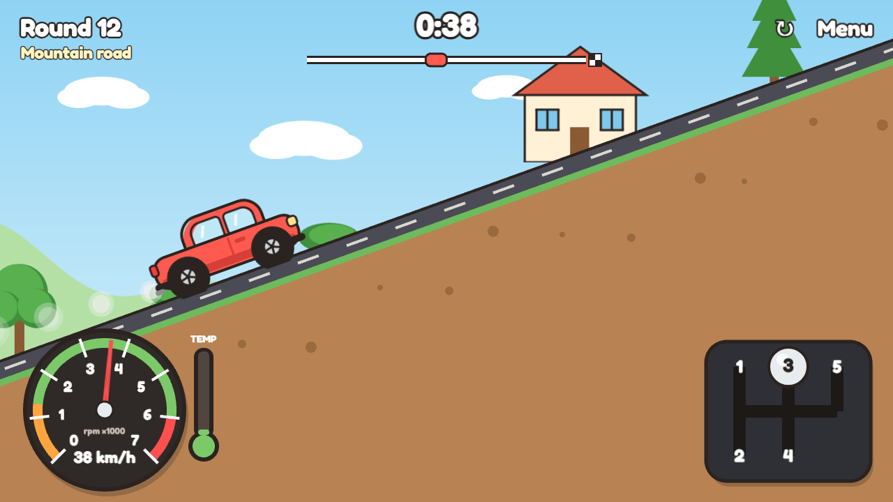

# Manual Car

A small browser game made for [GitHub Game Off 2026](https://itch.io/jam/game-off-2026), whose
theme is **SHIFT**.

The car drives itself. It speeds up to the limit and brakes for speed bumps and red lights. All you
do is change gear:

- **Too high a gear** and the engine lugs, judders and stalls. A stall ends the round.
- **Too low a gear** and the car can't go any faster, so the clock runs out. Take a steep hill down
  in too low a gear and the engine over-revs until it blows.
- **Only 1st pulls away**, and only 1st is slow enough for a speed bump.

There are 15 rounds, each a road to the finish flag against the clock, with hills, mud, speed bumps,
traffic lights, a town, a mountain road and rush hour.



## Controls

|                   | Keyboard           | Mouse or touch               |
| ----------------- | ------------------ | ---------------------------- |
| Change up         | ↑, W or Shift      | Tap a gear on the gear stick |
| Change down       | ↓ or S             |                              |
| Pick a gear       | 1–5, N for neutral |                              |
| Restart the round | R                  | ↻                            |

## Running it

You need Node.js 22 or later.

```sh
npm install
npm run dev
```

Then open http://127.0.0.1:5200. In development, `?play` skips the menu, `?round=N` starts on
round N, `?bot` lets the built-in driver play and `?speed=N` runs the game N times faster.

| Script             |                                                                                         |
| ------------------ | --------------------------------------------------------------------------------------- |
| `npm run build`    | Type-checks and builds the game into `dist/`                                            |
| `npm test`         | Unit tests for the driving model and the rounds (Vitest)                                |
| `npm run test:e2e` | Plays the game in Microsoft Edge (Playwright). `PW_CHANNEL=chromium` uses its Chromium. |
| `npm run lint`     | ESLint and Prettier                                                                     |
| `npm run tune`     | Prints how each round plays for the test drivers                                        |
| `npm run zip`      | Builds the upload for itch.io (needs Python)                                            |
| `npm run itch-art` | Renders the itch.io cover and screenshots into `itch/` (with the dev server running)    |

## How it works

The game is written in TypeScript with [Phaser 3](https://phaser.io/). There are no image or sound
files: everything is drawn with Phaser's graphics API, and the sounds, the engine included, are
synthesized with the Web Audio API.

- `src/sim/` is the game logic, with no rendering. `car.ts` models the drivetrain: gear ratios, a
  torque curve, stalling, the rev limiter and over-revving, and the automatic throttle, brakes and
  clutch. `road.ts` builds a road from its stretches and grades, `rounds.ts` defines the rounds and
  `run.ts` plays one, with the rules that end it. The simulation always advances in fixed steps of
  1/60 s, so a round plays out the same way every time.
- `src/sim/drivers.ts` has a bot that changes gear by the revs. The unit tests use it, along with a
  careless driver and drivers who stay in one gear, to check every round: the bot and the careless
  driver reach the flag in time, and a single gear doesn't.
- `src/view/` draws the road, the car and the dashboard, and `src/scenes/` holds the Phaser scenes.

## License

Copyright © 2026 Faizal Shaji. All rights reserved: the source is public for the game jam, but it
isn't licensed for reuse. See [LICENSE](LICENSE).
